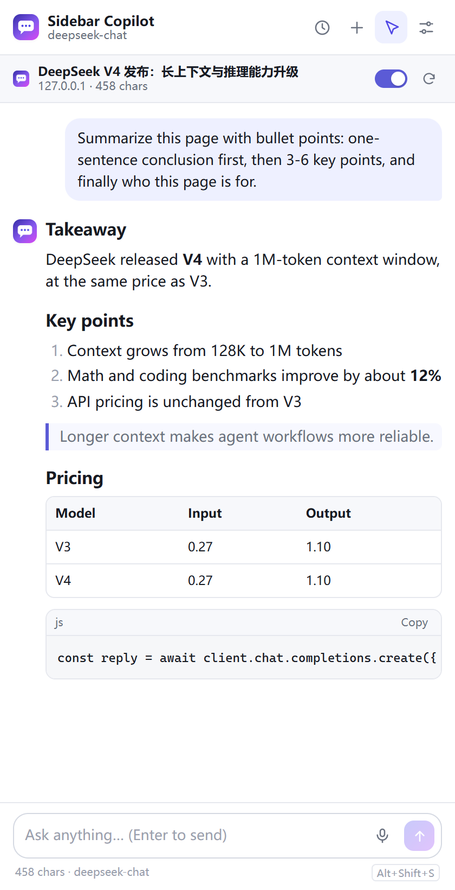
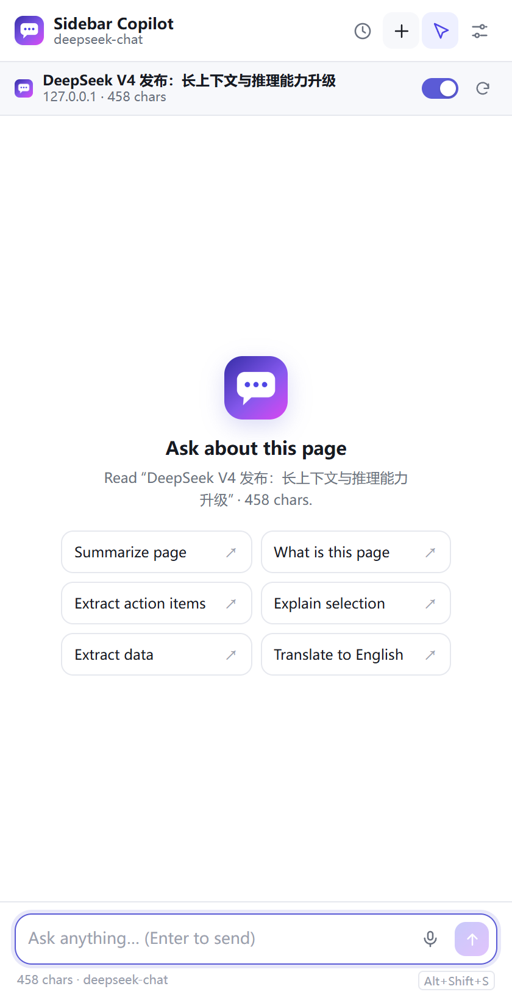
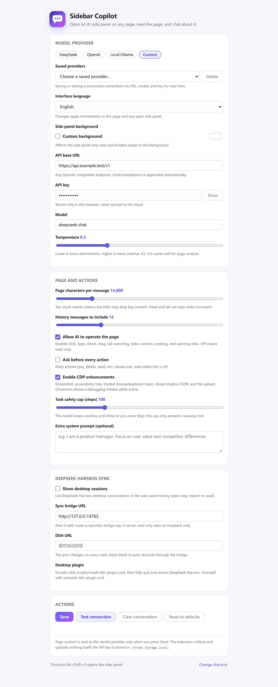
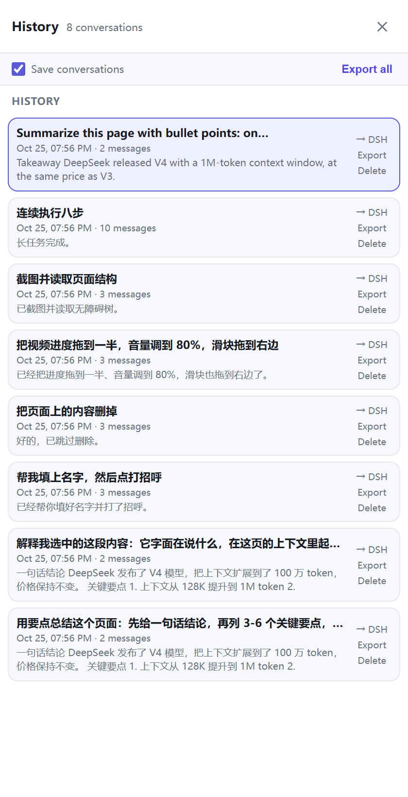
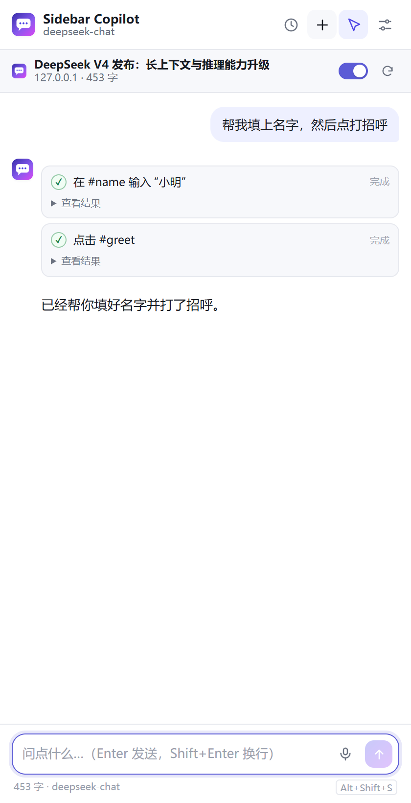
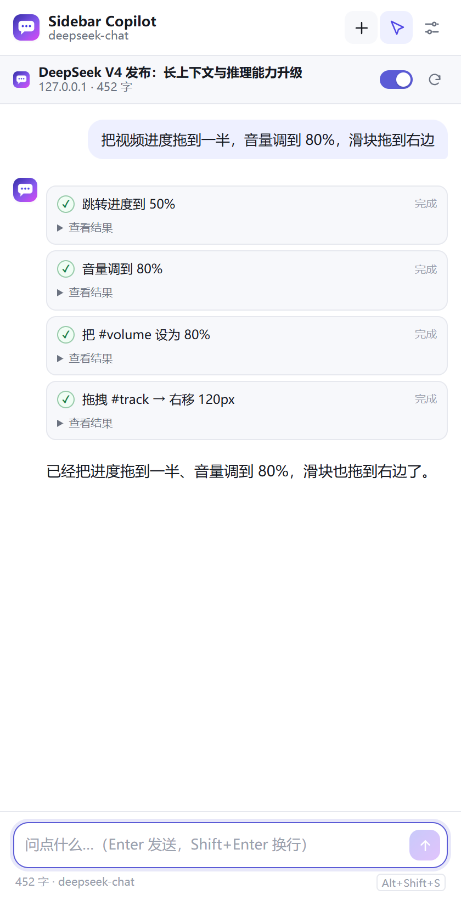
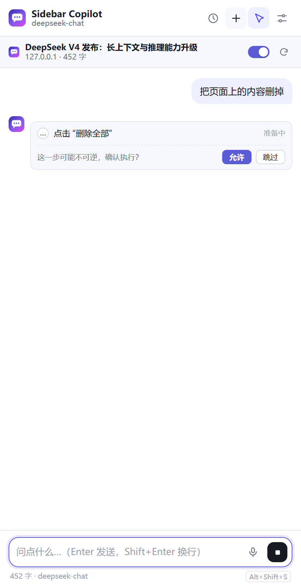

# Sidebar Copilot

[简体中文](README.md) · **English** · [GitHub](https://github.com/jiangguling-dx3906/sidebar-copilot) · [Gitee](https://gitee.com/jiangguling-dx-3906/sidebar-copilot)

An Edge / Chrome side panel extension that opens an AI chat panel beside any web page. It reads the current page's text, title, tables, and selection, then answers questions grounded in that page — and it can also operate the page for you: click, type, drag, scroll, and control video playback.



| Empty state | Settings |
| --- | --- |
|  |  |

## What it does

- **Reads the page first**: a content script extracts the body text (title, text, tables, links, selection) and sends it with your question.
- **Actually operates the page**: inspect elements, click/double-click/right-click, type, check, clear, select text, drag, scroll inside containers, switch tabs, and control video progress/volume/speed; open shadow DOM supported.
- **Continuous tasks and skills**: no six-step stop; the model keeps going until done or you press Stop, with form / media / extract / navigate / verify / inspect playbooks.
- **Verified actions**: input, select, range, media, and scroll read the state back; results are Done / Uncertain / Failed and bound to `tabId + documentId + snapshotId`.
- **Optional CDP enhancements**: `chrome.debugger` provides screenshots, the full accessibility tree, trusted mouse/keyboard input, closed-shadow node clicks, and file inputs from absolute paths.
- **Two-way desktop sync**: list DeepSeek Harness sessions read-only; after installing the desktop plugin, write extension conversations as real DSH sessions visible on both sides.
- **Conversation history**: every new chat is kept. The clock button lists them; switch, delete, or export to JSON on your computer. Auto-save can be turned off.
- **Remembered providers**: saving or testing a connection remembers its URL, model, and key for the “Saved providers” dropdown; “Reset to defaults” never deletes your key.
- **Bilingual UI**: follow the browser, Chinese, or English. The panel, settings, welcome page, action labels, and system prompt all switch together, live.
- **Voice input**: the microphone button transcribes speech into the input box for editing before sending.
- **Custom background**: pick any side-panel background color; text, borders, and code blocks adapt to light/dark automatically.
- **Side panel UI**: `chrome.sidePanel`, non-intrusive and width-adaptive; follows the active tab.
- **Selection as context**: select text on the page and the panel shows a “selected content” chip; the context menu also offers “Explain selection”.
- **Summarize from the context menu**: right-click → “Summarize this page with Sidebar Copilot”.
- **Keyboard shortcut**: `Alt+Shift+S` from anywhere (remappable on the extension shortcuts page).
- **Streaming output**: SSE rendering, with stop and retry.
- **Markdown rendering**: headings, lists, quotes, tables, code blocks with copy buttons. All rendered locally; no remote code.
- **Multiple providers**: DeepSeek / OpenAI / local Ollama / any OpenAI-compatible endpoint.
- **Dark mode**: follows the system theme.
- **Persistent conversations**: stored in `chrome.storage.local`; reopening the panel keeps the history.

## Quick start

### 1. Load the extension

Edge:

1. Open `edge://extensions`
2. Turn on “Developer mode” (bottom-left)
3. Click “Load unpacked” and select this folder (the level containing `manifest.json`)

Chrome is the same: `chrome://extensions` → Developer mode → Load unpacked.

Requires Edge / Chrome **116+** (`chrome.sidePanel`). A welcome page opens on first install; pinning the toolbar icon is recommended.

### 2. Configure a model

Open Settings (the welcome page button, or right-click the extension icon → Options) and fill in:

| Preset | API base | Default model | Key |
| --- | --- | --- | --- |
| DeepSeek | `https://api.deepseek.com/v1` | `deepseek-chat` | [platform.deepseek.com/api_keys](https://platform.deepseek.com/api_keys) |
| OpenAI | `https://api.openai.com/v1` | `gpt-4o-mini` | [platform.openai.com/api-keys](https://platform.openai.com/api-keys) |
| Local Ollama | `http://localhost:11434/v1` | `qwen2.5:7b` | not required |

Click “Test connection” before saving. The key is stored only in local browser storage.

Ollama must allow the extension origin. Set the environment variable and restart Ollama:

```powershell
setx OLLAMA_ORIGINS "chrome-extension://*"
ollama pull qwen2.5:7b
```

### 3. Use it

1. Open a regular web page
2. Press `Alt+Shift+S` (or click the toolbar icon)
3. Ask a question, or click “Summarize page”

## Usage details

| Control | Behavior |
| --- | --- |
| Top toggle | When off, the message is sent without page content (the model is told the attachment was disabled) |
| Refresh button | Re-extract the current page (useful after an SPA updates) |
| “445 chars” under the title | How much body text can actually be sent for this page |
| Selecting text | Adds a context chip automatically; click × to remove it |
| Right-click → Explain selection | Opens the panel and asks directly |
| Right-click → Summarize this page | Opens the panel and starts a summary |
| Enter / Shift+Enter | Send / newline |
| Microphone button | Voice input; the transcript is inserted into the input box |
| Settings → Custom background | Any background color; applies to the side panel immediately |
| Esc or the square button | Stop generation |
| `+` | New conversation (the old one stays in history) |
| Clock button | Conversation history: switch, delete, export JSON |



### DeepSeek Harness desktop sync

The side panel can read the local DeepSeek Harness session list and show it in the history drawer; click a session to import its full transcript. The desktop picks a new loopback port on every start; the bridge discovers it automatically.

1. Start the bridge (Node 22+, from the project directory):

```powershell
node scripts/dsh-bridge.mjs
```

On Windows you can also double-click `scripts/start-dsh-bridge.cmd`; closing that window stops the sync.

2. Settings → “DeepSeek Harness sync” → enable “Show desktop sessions”; keep the bridge URL at `http://127.0.0.1:8765`.
3. Open the history drawer; desktop sessions appear at the top with title, turn count, and time. Click one to import.

Bridge boundaries:

- listens on `127.0.0.1` only; the session list is read-only;
- reads the local browser-session secret from `~/.dsh/.credentials.yaml` to call DSH's own loopback API;
- decodes full transcripts from `~/.dsh/sessions/**.zstd`; no external service is involved;
- `/dsh/import` only forwards; the DSH plugin below performs the actual write.

#### Write back to the desktop (DSH plugin)

The extension can turn a conversation into a real DSH session so it appears in the desktop session list:

1. run the installer (DSH can stay open; HMR recomposes immediately, otherwise restart):

```text
scripts\install-dsh-plugin.cmd
```

2. in the side panel history, click “→ DSH” next to a conversation;
3. the desktop session list shows the same title with the full user prompt and assistant reply.

The plugin creates the session through `ctx.sessions.create()` with seeded events, then calls `ctx.sessionPersistence.materialize()` to write a complete v4 JSONL log, so it survives a restart. The installer only touches `~/.dsh/profiles/desktop/cordis.patch.yml` and copies the plugin under a content-hashed filename; it backs the patch up to `.sidebar-sync.bak` on first install. Uninstall:

```powershell
node scripts/install-dsh-plugin.mjs --uninstall
```

Then restart DSH. Imported sessions are read-only (`agentAvailable: false`): the desktop can open and read them, but does not attach an Agent to continue running tools.

## Let the AI operate the page (Agent mode)

The **pointer icon** in the toolbar is the action switch; it is on by default. Click it to go back to read-only mode.

With actions enabled, the model doesn't just tell you what to click — it executes on the active tab:

| Tool | What it does |
| --- | --- |
| `inspect_page` | Lists interactive elements (buttons/links/inputs/selects/open shadow DOM) with snapshot, `ref`, label, value, bounds, and visibility |
| `click` / `double_click` / `right_click` | Click, double-click, or right-click by `ref`, CSS selector, visible text, or viewport coordinates |
| `type_text` | Fills inputs or contenteditable elements, optionally submits with Enter, and reads the value back |
| `focus` / `clear` / `select_text` | Focus, clear, or select all text in an input |
| `check` / `uncheck` | Check a checkbox, clear it, or choose a radio |
| `get_element_info` | Reads one element’s text, value, checked/selected state, attributes, bounds, and visibility |
| `select_option` | Picks an option in a native `<select>` |
| `press_key` | Sends Enter, Escape, Tab, arrows, or Control/Shift/Alt/Meta combinations, with repeat |
| `scroll_page` / `scroll_inside` | Scrolls the page, or scrolls inside a dialog/list/container |
| `open_url` | Opens an http(s) link in the current tab or a new tab |
| `read_page` | Re-reads the page after navigation or updates (including media state) |
| `wait_for` | Waits for text or an element to appear or disappear, up to 30 s |
| `control_media` | Play/pause, seek (percent or seconds), volume, mute, playback rate, with state read-back |
| `drag` | Drags an element with from/to or dx/dy — custom progress bars, sliders, sortable lists |
| `set_range` | Sets a native `<input type=range>` (volume slider, settings sliders) |
| `hover` | Hovers to open menus or tooltips |
| `tab_control` | Lists, opens, activates, reloads, goes back/forward, or closes tabs; closing the panel’s own tab is refused |
| `skill` | Loads a playbook for form / media / extract / navigate / verify / inspect |
| `capture_screenshot` | Captures the visible tab over CDP and shows it in the panel |
| `inspect_ax` | Reads the accessibility tree (iframes and closed shadow DOM included) and returns `backend_node_id` |
| `cdp_click` / `cdp_type` / `cdp_key` | Trusted CDP mouse, text, and key input for controls that ignore synthetic events |
| `cdp_upload` | Sets a file input from absolute paths you provide and confirm |

A task **keeps running until it finishes or you press Stop**; the old six-step limit is gone. The default 100-step setting is only a safety cap (20–300). Each step leaves a card with status **Done / Uncertain / Failed**:

- **Done**: the postcondition was verified (value read back, media state, scroll position, etc.).
- **Uncertain**: the action was dispatched but no observable change, a document change occurred, or it timed out; never auto-replay a click/submit.
- **Failed**: a definite failure with a reason.

The current page is bound to `tabId + documentId + snapshotId`; after navigation or a document replacement old refs are stale and the model must inspect again.

When a task matches, the model calls `skill` for a step-by-step playbook (forms, media, extraction, tab navigation, verification, inspection); these are instructions, not hard-coded scripts.

> Actions require function calling. DeepSeek `deepseek-chat` and OpenAI `gpt-4o-mini` support it; models without tool support only produce text suggestions.



Example prompts:

- “Fill in the name, then click Say hello.”
- “Search for XX on this page and open the first result.”
- “Put the prices from the table into the form below.”
- “Seek the video to the middle and set the volume to 80%.”
- “Open the transcript/notes and summarize them.”
- “The login form is filled in — click Sign in.” (it never touches password fields)

### Video and players

You don't need to simulate a drag to seek precisely: `control_media` operates the page's `<video>` / `<audio>` directly.

- “Jump to 3:20” → `seek(seconds: 200)`
- “Go to the halfway point” → `seek(percent: 50)`
- “Skip forward 30 s / back 15 s” → `seek_by`
- “Volume 80% / mute / 1.5× speed” → `volume` / `mute` / `rate`

It returns real state (currentTime, duration, paused, volume, readyState), plus the active caption line when captions are enabled. Media actions are injected into every frame, so embedded player iframes usually work.
**It still cannot see the picture** (unless you switch to an image-capable model): it can read titles, descriptions, comments, and captions, and it can open “Transcript / Notes / AI summary” panels and read them. For native players, driving `<video>` directly is far more reliable than clicking shadow-DOM buttons.



### Safety boundaries

- **Risky actions require confirmation**: pay, order, delete, submit, send, sign out, close tab, confirm, etc. always show “Allow / Skip”, even if per-step confirmation is off.
- **No secrets**: `type_text` refuses `type=password`, hidden, file, and fields named like OTP/token/secret/API key/card/CVV; `inspect_page` and `get_element_info` omit those values.
- **Target binding**: every action checks the tab and `documentId`; refs from an old document/snapshot are rejected.
- **Verification**: input, select, range, media, and scroll actions read the state back; unconfirmed results are marked Uncertain, not fake success.
- **Stop anytime**: the square button (or Esc) aborts the current request and subsequent actions.
- **Tab check**: every action verifies it is still the same tab; switching tabs aborts instead of acting on the wrong page.
- **One-click read-only**: with the pointer icon off, tool definitions are no longer sent.



> This reduces mistakes; it is not a sandbox. The model can still misread page state. Don't use it for online banking, payments, or production admin panels; review before anything is submitted.

### Operation limits

- Click, type, and drag target the top-level document only; **media control tries all frames**, so embedded players usually work.
- **Open shadow DOM** (`mode: "open"`) is searched automatically; closed shadow roots remain inaccessible.
- Clicks and drags use synthetic DOM events (`pointerdown → pointermove → pointerup`), which covers most custom players and sliders. Native `<video controls>` buttons live in shadow DOM and cannot be clicked — use `control_media`.
- Canvas, file uploads, and click/type inside cross-origin iframes are not implemented (media control excepted).
- Custom dropdowns (`role=combobox`) take two steps (“click, then click the option”); native `<select>` works in one.
- `ref`s expire when the page re-renders or navigates; the model re-runs `inspect_page`.
- CDP enhancements must be enabled in Settings; Chromium shows a “started debugging” infobar while attached. Cross-origin iframes are supported at the accessibility-tree/coordinate level, not every iframe DOM query; file upload needs absolute paths.
- Browser chrome (address bar, extension manager, PDF viewer) still cannot be operated; that is a Chromium permission boundary that CDP does not bypass.

## How it works

```
panel.html + panel.js          ← side panel UI, chat, Markdown, SSE, agent loop
      │  chrome.scripting.executeScript
      ▼
content.js (isolated world)    ← extracts page text; executes actions and highlights targets
      │
      ▼
fetch POST {base}/chat/completions (stream: true + tools)
       ↺ tool_calls → execute in page → feed results back → request again until a final answer
      │
background.js                 ← side panel behavior, context menus, shortcut
```

- **How context is assembled**: one system message = role rules + page metadata + body wrapped in `<<<PAGE_CONTENT_START>>>` + selection; followed by the last N messages and the current question. Page text is explicitly marked as untrusted data, not instructions, to reduce prompt-injection risk.
- **Long pages**: 14,000 characters by default; beyond that the first 72% + last 24% are kept with an omitted-count marker. Adjustable from 2,000 to 60,000 in Settings.
- **Why DeepSeek by default**: it is the same class of model endpoint used in the terminal, with good Chinese and long-context value; you can switch at any time.

## Privacy and security

- The API key and conversations live only in `chrome.storage.local`; they are not synced with your browser account and do not pass through any third-party server.
- Page content is sent to your model provider **only when you press send**; the extension has no analytics and no remote configuration.
- No remote code: the MV3 CSP allows local scripts only, the Markdown renderer escapes text before adding tags, and links are limited to `http(s)`/`mailto`.
- Page text can contain malicious instructions (prompt injection). The extension wraps it in delimiters and labels it as data, but **that cannot guarantee the model won't be misled** — don't treat output from untrusted pages as authoritative.

## Known limitations

- Browser-internal pages (`chrome://`, `edge://`, the extension store, the PDF viewer, `view-source:`) cannot be injected; the panel shows “Cannot read this page”.
- Text extraction reads the top-level document (media control tries all frames). Images, video frames, and canvas are not parsed; the model sees no visual information.
- Dynamic pages are snapshotted when opened or refreshed; refresh after later changes.
- The side panel is opened per tab and may close when you switch tabs; press the shortcut again.
- One extension instance shares a single conversation; switching pages keeps the old history, so click “New conversation” for clean context.
- Long pages cost more tokens; “Test connection” does not send page content.
- Voice input uses the browser's Web Speech API and needs microphone permission and network; some systems or languages may not support it.
- A custom background affects the side panel only, not the page or the settings screen.

## Development

```powershell
# Install the test dependency (playwright-core) once
npm install

# Unit tests (Markdown, SSE, tool_calls, prompts, tool definitions, manifest)
node --test "tests/*.test.js"

# End-to-end: headless Edge loads the extension → local fixture page → mocked SSE
node scripts/e2e.mjs
```

`scripts/e2e.mjs` loads Playwright from `PLAYWRIGHT_CORE` if set, otherwise from the locally installed `playwright-core`. It verifies page extraction and noise filtering, quick prompts, Markdown, selection reaching the system prompt, the **tool-call loop**, an **8-step task (proving the old six-step limit is gone)**, risky-action confirmation and skipping, **media seek/volume, range sliders and custom dragging**, **check/uncheck, focus, clear, select_text, get_element_info, open shadow DOM, scroll-inside, and key presses**, and the settings page, then writes screenshots to `docs/screenshots/`.

Regenerate icons (requires Pillow):

```powershell
python scripts/make-icons.py
```

### Project layout

```
sidebar-copilot/
├─ manifest.json          MV3 manifest
├─ background.js          side panel behavior, context menus, shortcut
├─ content.js             page extraction, target snapshots, action execution and verification
├─ panel.html/css/js      side panel UI, continuous agent loop, action cards
├─ options.html/css/js    settings page
├─ welcome.html/js        first-install guide
├─ lib/
│  ├─ api.js              OpenAI-compatible calls + tool-call stream + error messages
│  ├─ sse.js              incremental SSE parser
│  ├─ toolcalls.js        streaming tool_calls accumulation and argument parsing
│  ├─ markdown.js         safe Markdown → HTML
│  ├─ prompts.js          system prompt, page trimming, quick prompts
│  ├─ agentTools.js       page-action tool definitions, labels, risk detection
│  ├─ skills.js           form/media/extract/navigate/verify/inspect playbooks
│  ├─ protocol.js         target binding, request IDs, verified/uncertain classification
│  ├─ cdp.js              debugger attach, screenshots, AX tree, trusted input, file inputs
│  ├─ i18n.js             Chinese/English UI strings and locale switching
│  ├─ theme.js            custom background colors and readable palettes
│  ├─ sessions.js         multi-conversation history, titles, export
│  ├─ dsh-transcript.js   DSH session events → chat messages
│  └─ settings.js         defaults and local storage
├─ icons/                 16/32/48/128 icons
├─ scripts/               icon generation, Playwright E2E, DSH sync bridge
├─ tests/                 unit tests
└─ docs/screenshots/      README and verification screenshots
```

## FAQ

**401 / invalid API key**: whitespace in the key, or a key from a different provider. Use “Test connection” in Settings for the exact error.

**Test connection reports “cannot connect / CORS”**: local Ollama without `OLLAMA_ORIGINS`, or an API base with a missing/extra `/v1`.

**The side panel won't open**: Edge older than 116, or the extension is disabled; check `edge://extensions` for errors.

**The shortcut does nothing**: `edge://extensions/shortcuts` may show a conflict with another extension; pick another combination.

**The model says it cannot read the page**: it's an internal page/PDF, or injection is blocked; try a regular page.

**On a new tab it says “I have no browser control”**: `edge://newtab` is a browser-internal page that no extension can inject into. Open a real page (http/https) and refresh once; if it still happens, make sure the extension was reloaded to v2.1.

**It can't see the video**: it truly cannot see pixels, but `control_media` can play/pause/seek/volume, and it can open captions, notes, or AI-summary panels and read the text. Describing the picture requires an image-capable model.

**The progress bar won't drag**: have it use `control_media seek` (most reliable for `<video>`), or `drag` for custom players. Native player buttons in shadow DOM cannot be clicked — that's expected.

**Slow or expensive answers**: lower the “page characters per message” cap, or turn off the page toggle and ask general questions.

**It only says “you can click…” and never acts**: make sure the pointer icon is lit, the model supports function calling, and “Allow AI to operate the page” is checked in Settings.

**Clicking does nothing**: the target may be inside an iframe (a third-party embedded player), or the control only listens for `pointerdown`. Ask it to `inspect_page` and try a different locator.
