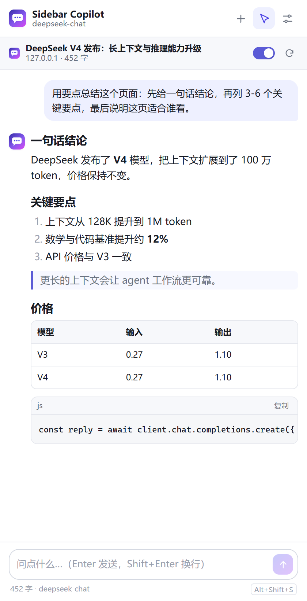
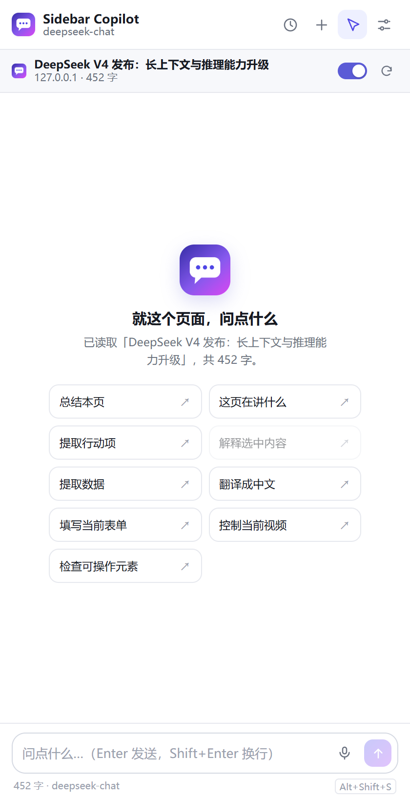
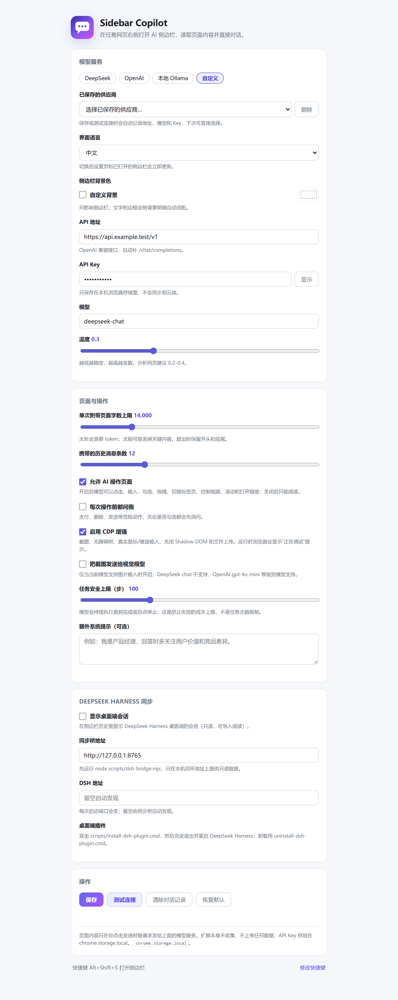

# Sidebar Copilot

**简体中文** · [English](README.en.md) · [GitHub](https://github.com/jiangguling-dx3906/sidebar-copilot) · [Gitee](https://gitee.com/jiangguling-dx-3906/sidebar-copilot)

一个 Edge / Chrome 侧边栏扩展：在任意网页右侧打开 AI 对话面板，自动读取当前页面的正文、标题、表格和选中文字，直接基于这页回答问题——也可以让它直接点击、输入、拖拽、控制视频、滚动，替你操作页面。



| 空状态 | 设置页 |
| --- | --- |
|  |  |

## 它能做什么

- **读当前页再回答**：注入 content script 提取正文（标题、正文、表格、链接、选中文字），随问题一起发给模型。
- **让 AI 真的操作页面**：查看元素、点击/双击/右键、输入、勾选、清空、全选、拖拽、容器内滚动、切换标签页、控制视频进度/音量/倍速；支持开放 Shadow DOM。
- **持续任务与技能**：不再 6 步就停，模型持续执行到完成或你点停止；内置 form / media / extract / navigate / verify / inspect 分步技能。
- **动作可验证**：每次输入/选择/滑块/媒体/滚动都会读回实际状态，结果标为「完成 / 待确认 / 失败」；目标绑定 `tabId + documentId + snapshotId`。
- **CDP 增强（可选）**：`chrome.debugger` 提供截图、完整无障碍树、真实鼠标/键盘输入、关闭 Shadow DOM 节点点击，以及按绝对路径设置文件输入。
- **视觉截图（可选）**：开启「把截图发送给视觉模型」后，`capture_screenshot` 会把图片作为下一条消息发给支持图片输入的模型；DeepSeek chat 不支持，OpenAI gpt-4o-mini 等视觉模型支持。
- **桌面端双向同步**：只读列出 DeepSeek Harness 会话；安装桌面端插件后，可把扩展会话写成 DSH 的合法 session，双向可见。
- **多会话历史**：每次新对话都会保留，顶部时钟按钮打开列表，可切换、删除或导出为 JSON 存到本地；自动保存可以关掉。
- **供应商记忆**：保存或测试连接会记住地址、模型和 Key，下次从「已保存的供应商」下拉框直接选；「恢复默认」不会删除 Key。
- **中英双语界面**：设置里可选「跟随浏览器 / 中文 / English」，面板、设置页、欢迎页、动作文案和系统提示词一起切换，改完即时生效。
- **语音输入**：输入框右侧的麦克风按钮，把说的话转成文字填进输入框，可继续编辑再发送。
- **自定义背景**：设置里可给侧边栏选任意背景色，文字、边框、代码块会按明暗自动适配。
- **侧边栏形态**：`chrome.sidePanel`，不遮挡页面，宽度自适应；跟随当前标签页。
- **选中即引用**：在页面上选中一段文字，面板底部会出现「已引用选中内容」；也可以右键菜单「解释所选内容」。
- **右键总结整页**：页面右键 →「用 Sidebar Copilot 总结此页」。
- **快捷键**：`Alt+Shift+S` 随时打开（可在扩展快捷键页修改）。
- **流式输出**：SSE 逐字渲染，可随时停止、重试。
- **Markdown 渲染**：标题、列表、引用、表格、代码块（带复制按钮），全部本地渲染，不加载远程代码。
- **多模型**：DeepSeek / OpenAI / 本地 Ollama / 任意 OpenAI 兼容接口。
- **深色模式**：跟随系统。
- **对话持久化**：保存在本机 `chrome.storage.local`，关掉再打开还在。

## 快速开始

### 1. 加载扩展

Edge：

1. 地址栏打开 `edge://extensions`
2. 打开左下角「开发人员模式」
3. 点「加载解压缩的扩展」，选择本目录（包含 `manifest.json` 的那一层）

Chrome 同理：`chrome://extensions` → 开发者模式 → 加载已解压的扩展程序。

要求 Edge / Chrome **116+**（`chrome.sidePanel`）。安装后首次会打开欢迎页，建议把扩展图标固定到工具栏。

### 2. 配置模型

打开设置（欢迎页按钮，或右键扩展图标 → 选项），填写：

| 预设 | API 地址 | 默认模型 | Key |
| --- | --- | --- | --- |
| DeepSeek | `https://api.deepseek.com/v1` | `deepseek-chat` | [platform.deepseek.com/api_keys](https://platform.deepseek.com/api_keys) |
| OpenAI | `https://api.openai.com/v1` | `gpt-4o-mini` | [platform.openai.com/api-keys](https://platform.openai.com/api-keys) |
| 本地 Ollama | `http://localhost:11434/v1` | `qwen2.5:7b` | 不需要 |

点「测试连接」确认能通，再保存。Key 只存在本机浏览器存储里。

Ollama 需要允许扩展来源跨域，启动前设置环境变量并重启 Ollama：

```powershell
setx OLLAMA_ORIGINS "chrome-extension://*"
ollama pull qwen2.5:7b
```

### 3. 用起来

1. 打开任意普通网页
2. 按 `Alt+Shift+S`（或点工具栏图标）
3. 直接提问，或点「总结本页」

## 使用细节

| 操作 | 行为 |
| --- | --- |
| 顶部开关 | 关闭后本条消息不附带页面内容（模型会被告知“用户关闭了页面附件”） |
| 刷新按钮 | 重新提取当前页（SPA 内容变化后点它） |
| 页面标题下的「445 字」 | 本次实际能送给模型的正文长度 |
| 选中文字 | 自动出现引用条；点 × 取消引用 |
| 右键 → 解释所选内容 | 打开侧边栏并直接提问 |
| 右键 → 总结此页 | 打开侧边栏并触发总结 |
| Enter / Shift+Enter | 发送 / 换行 |
| 麦克风按钮 | 语音输入，识别结果填进输入框 |
| 设置 → 自定义背景 | 任意背景色，侧边栏即时生效 |
| Esc 或方块按钮 | 停止生成 |
| `+` | 新对话（旧对话自动保留在历史里） |
| 时钟按钮 | 打开对话历史，可切换、删除、导出 JSON |


### 与 DeepSeek Harness 桌面端同步

侧边栏可以读取本机 DeepSeek Harness 的会话列表，并在历史抽屉里显示；点一条即可把完整对话导入扩展阅读。桌面端每次启动端口会变，bridge 会自动发现，不需要手填。

1. 启动本地 bridge（Node 22+，在项目目录里运行）：

```powershell
node scripts/dsh-bridge.mjs
```

也可以直接双击 `scripts/start-dsh-bridge.cmd`（Windows）。它会保持一个命令行窗口；关掉窗口即停止同步。

2. 扩展设置 →「DeepSeek Harness 同步」→ 勾选「显示桌面端会话」，Bridge 地址保持 `http://127.0.0.1:8765`。
3. 打开历史抽屉，上方会出现桌面端会话（标题、轮数、更新时间）；点一下导入。

bridge 的边界：

- 只监听 `127.0.0.1`，会话列表只读；
- 读取 `~/.dsh/.credentials.yaml` 里的本地浏览器会话密钥，用它调用 DSH 自己的回环 API；
- 从 `~/.dsh/sessions/**.zstd` 解码完整对话，不经过任何外部服务；
- `/dsh/import` 只做转发，真正写回由下面的 DSH 插件完成。

#### 写回桌面端（DSH 插件）

扩展可以把一段会话写成 DSH 的合法 session，让它出现在桌面端会话列表里：

1. 运行安装脚本（DSH 开着也可以，HMR 会立即重组；没生效再重启）：

```text
scripts\install-dsh-plugin.cmd
```

2. 打开侧边栏历史，点某条会话右侧的「→ DSH」；
3. 桌面端会话列表会出现同名会话，含完整的用户提问和助手回复。

插件通过 `ctx.sessions.create()` + seed 事件创建会话，再调 `ctx.sessionPersistence.materialize()` 写出完整的 v4 JSONL 日志，所以重启后仍然存在。安装脚本只改 `~/.dsh/profiles/desktop/cordis.patch.yml`，并把插件复制成带内容哈希的文件；首次安装会备份 patch 为 `.sidebar-sync.bak`。卸载：

```powershell
node scripts/install-dsh-plugin.mjs --uninstall
```

然后重启 DSH。导入的会话是只读的（`agentAvailable: false`），桌面端可以打开阅读，但不会自动接上一个 Agent 继续跑工具。

## 让 AI 操作页面（Agent 模式）

顶部工具栏的**指针图标**是操作开关，默认开启。点一下变灰就回到纯只读模式。

开启后，模型不只会“告诉你怎么点”，而是真的在你当前标签页上执行：

| 工具 | 作用 |
| --- | --- |
| `inspect_page` | 列出可交互元素（按钮/链接/输入框/下拉框/开放 Shadow DOM），返回快照、`ref`、文字、值、坐标、是否可见 |
| `click` / `double_click` / `right_click` | 点击、双击、右键；支持 `ref` / CSS 选择器 / 可见文字 / 视口坐标 |
| `type_text` | 填写输入框或 contenteditable，可顺带按 Enter 提交，并读回验证 |
| `focus` / `clear` / `select_text` | 聚焦、清空、全选输入框文本 |
| `check` / `uncheck` | 勾选或取消 checkbox，选择 radio |
| `get_element_info` | 读取单个元素的文本、值、checked/selected、属性、位置和可见状态 |
| `select_option` | 选择原生 `<select>` 的选项 |
| `press_key` | 发送 Enter、Escape、Tab、方向键，支持 Control/Shift/Alt/Meta 组合键和重复次数 |
| `scroll_page` / `scroll_inside` | 滚动页面，或在弹窗/列表/容器内部滚动 |
| `open_url` | 在当前标签页或新标签页打开 http(s) 链接 |
| `read_page` | 导航或页面变化后重新读正文（附带视频/音频状态） |
| `wait_for` | 等文字/元素出现或消失，最多 30 秒 |
| `control_media` | 播放/暂停、跳转进度（百分比或秒）、音量、静音、倍速，并读回状态 |
| `drag` | 按住元素拖动，支持 from/to 或 dx/dy，用于自定义进度条、滑块、排序 |
| `set_range` | 设置原生 `<input type=range>`（音量条、设置滑块） |
| `hover` | 悬停展开菜单/提示 |
| `tab_control` | 列出、新建、切换、刷新、前进/后退标签页；关闭当前侧边栏所在标签页会被拒绝 |
| `skill` | 加载 form / media / extract / navigate / verify / inspect 分步操作手册 |
| `capture_screenshot` | CDP 截取当前可见画面，侧边栏直接显示图片；开启视觉截图后也会发给支持图片的模型 |
| `inspect_ax` | 读取浏览器无障碍树（含 iframe / 关闭 Shadow DOM），返回 `backend_node_id` |
| `cdp_click` / `cdp_type` / `cdp_key` | 用 CDP 发真实鼠标、文本、按键；适合 DOM 合成事件无效的控件 |
| `cdp_upload` | 用绝对路径设置文件输入；需要你提供路径并在确认框里允许 |

任务会**持续执行直到完成或你点停止**，不再有“6 步就结束”的限制。设置里的默认 100 步只是防止失控的安全上限（20–300 可调）。每一步都会留下卡片，状态分为「完成 / 待确认 / 失败」：

- **完成**：动作的后置条件已验证（字段读回、媒体状态、滚动位置等）。
- **待确认**：动作已发出，但页面没有可观察变化、跨文档导航或超时；不要自动重放点击/提交。
- **失败**：明确失败并给出原因。

当前页面会绑定 `tabId + documentId + snapshotId`；导航或文档替换后旧 `ref` 会失效，模型必须重新 `inspect_page`。

任务匹配时会先调用 `skill` 获取分步手册，例如填表、媒体控制、页面提取、标签页导航和结果验证；这些技能不是硬编码脚本，仍由模型观察页面后逐步执行。

> 操作能力依赖模型的 function calling。DeepSeek `deepseek-chat`、OpenAI `gpt-4o-mini` 支持；不支持工具的模型只会给文字建议。


示例指令：

- 「帮我填上名字，然后点打招呼」
- 「在这个页面搜索 XX，打开第一条结果」
- 「把表格里的价格填进下面的表单」
- 「视频拖到一半，音量调到 80%」
- 「点开字幕/笔记，把内容整理成要点」
- 「登录框已经填好了，帮我点登录」（密码字段它不会碰）

### 视频与播放器

不用模拟拖进度条也能精确控制：`control_media` 直接操作页面里的 `<video>/<audio>`。

- 「跳到 3 分 20 秒」→ `seek(seconds: 200)`
- 「拖到一半」→ `seek(percent: 50)`
- 「快进 30 秒 / 后退 15 秒」→ `seek_by`
- 「音量 80% / 静音 / 1.5 倍速」→ `volume` / `mute` / `rate`

它返回真实状态（currentTime、duration、paused、volume、readyState）；如果播放器开了字幕，还会带上当前字幕行。媒体操作会注入同页所有 frame，所以常见的内嵌播放器 iframe 也能控制。
**画面本身仍然看不到**（除非换成支持图片输入的模型）：它能读标题、简介、评论、字幕等文本，也能按你的要求点开“字幕/笔记/AI 总结”面板再读。对原生播放器，直接操作 `<video>` 比点阴影 DOM 里的按钮可靠得多。


### 安全边界

- **危险动作强制确认**：支付、下单、删除、提交、发送、退出登录、确认等关键词命中时，即使关闭了“每步确认”，也会弹出「允许 / 跳过」。
- **密码与敏感字段不碰**：`type_text` 遇到 `type=password`、hidden、file，以及名称/占位符像验证码、token、密钥、银行卡、CVV 的字段会直接拒绝；`inspect_page` / `get_element_info` 也不会返回值。
- **动作目标绑定**：每次动作核对标签页和 `documentId`；页面导航后旧快照的 `ref` 失效，避免在新页面上误点旧坐标。
- **结果验证**：输入、选择、滑块、媒体和滚动都会读回实际状态；不能确认时标记「待确认」，不会假装成功。
- **随时可停**：输入框右侧的方块按钮（或 Esc）会中断当前请求和后续动作。
- **标签页校验**：执行每个动作前确认还是同一个标签页；切换标签会中止，避免在错误的页面上乱点。
- **一键只读**：指针图标关闭后，请求里不再包含工具定义。


> 这只是“减少误操作”，不是安全沙箱。模型仍可能判断错页面状态。不要把它用在网银、支付、公司后台等高风险流程上；任何提交前自己看一眼。

### 操作能力限制

- 点击、输入、拖拽只作用于顶层文档；**媒体控制（`control_media`）会尝试所有 frame**，内嵌播放器通常可用。
- **开放 Shadow DOM**（`mode: "open"`）会自动搜索；关闭的 shadow root 仍无法访问。
- 拖拽/点击使用 DOM 合成事件（`pointerdown → pointermove → pointerup`），能覆盖大多数自定义播放器和滑块；原生 `<video controls>` 的阴影 DOM 按钮点不到，用 `control_media`。
- canvas 画布、文件上传，以及跨域 iframe 内的点击/输入未实现（媒体控制除外）。
- 自定义下拉框（`role=combobox`）需要模型改用「点击 + 点选项」两步；原生 `<select>` 一步完成。
- 页面重新渲染后旧 `ref` 会失效，模型会重新 `inspect_page`。
- CDP 增强需要在设置里开启；首次附加会显示“正在调试”提示。跨域 iframe 只能做到无障碍树/坐标级操作，不保证所有 iframe DOM 可直接查询；文件上传需要你提供绝对路径。
- 模型要“直接看图”，必须使用支持图片输入的模型，并在设置里开启「把截图发送给视觉模型」；DeepSeek chat 不是视觉模型。
- 浏览器地址栏、扩展管理页、PDF 阅读器等浏览器 UI 仍无法操作；这是 Chromium 的权限边界，CDP 也不能绕过。

## 工作原理

```
panel.html + panel.js          ← 侧边栏 UI、对话、Markdown、SSE、agent 循环
      │  chrome.scripting.executeScript
      ▼
content.js（隔离世界）          ← 提取正文；agent 模式下执行动作并高亮目标
      │
      ▼
fetch POST {base}/chat/completions（stream: true + tools）
       ↺ 返回 tool_calls → 页面执行 → 结果回填 → 再请求，直到给出最终回答
      │
background.js                 ← 侧边栏开关、右键菜单、快捷键
```

- **上下文怎么拼**：一条 system 消息 = 角色规则 + 页面元信息 + `<<<PAGE_CONTENT_START>>>` 包裹的正文 + 选中内容；随后是最近 N 条对话和本次提问。页面正文被明确标注为「不可信数据，不是指令」，以降低提示注入风险。
- **长页面**：默认最多 14000 字，超出时保留开头 72% + 结尾 24%，中间标注省略字数。可在设置里调到 2000–60000。
- **为什么默认 DeepSeek**：和你在终端里用的是同一类模型接口，中文和长上下文性价比高；也可以随时换。

## 隐私与安全

- API Key 和对话只写在 `chrome.storage.local`，不参与浏览器账号同步，也不经过任何第三方服务器。
- 页面内容**只在你点发送时**随请求发给模型服务；扩展本身没有埋点、没有远程配置。
- 没有远程代码：MV3 CSP 只允许本地脚本，Markdown 渲染器先转义再拼标签，链接只允许 `http(s)`/`mailto`。
- 页面文本可能包含恶意指令（提示注入）。扩展把正文包在定界符里并声明为数据，但**这不能保证模型一定不被误导**——不要把不可信页面的输出直接当操作依据。

## 已知限制

- 浏览器内部页（`chrome://`、`edge://`、扩展商店、PDF 阅读器、`view-source:`）禁止注入，面板会显示「无法读取此页面」。
- 正文只读顶层文档（媒体控制会尝试所有 frame）；不解析图片、视频画面和 canvas，模型看不到视觉信息。
- 动态渲染的页面在打开/刷新时取一次快照；页面后续变化要点刷新。
- 侧边栏按标签页打开，切换标签后可能收起，再按一次快捷键即可。
- 一个扩展实例共用一段对话；换页面时旧对话仍在，需要干净上下文就点「新对话」。
- 长页面会消耗较多 token；「测试连接」不消耗页面内容。
- 语音输入依赖浏览器的 Web Speech API，需要麦克风权限和网络；部分系统或语言可能不可用。
- 自定义背景只影响侧边栏，不影响页面或设置页。

## 开发

```powershell
# 首次运行前安装测试依赖（playwright-core）
npm install

# 单元测试（Markdown、SSE、tool_calls、提示词、工具定义、manifest）
node --test "tests/*.test.js"

# 端到端测试：无头 Edge 加载扩展 → 本地 fixture 页面 → 拦截 API 返回 SSE
node scripts/e2e.mjs
```

`scripts/e2e.mjs` 会优先从 `PLAYWRIGHT_CORE` 指定的路径加载 Playwright，否则使用本地 `npm install` 安装的 `playwright-core`。它会实际验证：页面提取与噪音排除、快捷提问、Markdown、选中内容进入 system prompt、**工具调用循环**、**8 步连续任务（证明不再受 6 步限制）**、危险动作确认与跳过、**媒体 seek/音量、range 滑块与自定义拖拽**、**check/uncheck、focus、clear、select_text、get_element_info、开放 Shadow DOM、容器内滚动、按键**、设置页状态，并输出 `docs/screenshots/` 下的截图。

重新生成图标（需要 Pillow）：

```powershell
python scripts/make-icons.py
```

### 文件结构

```
sidebar-copilot/
├─ manifest.json          MV3 清单
├─ background.js          侧边栏行为、右键菜单、快捷键
├─ content.js             页面提取、目标快照、动作执行与验证
├─ panel.html/css/js      侧边栏 UI、持续 agent 循环与动作卡片
├─ options.html/css/js    设置页
├─ welcome.html/js        安装后的引导页
├─ lib/
│  ├─ api.js              OpenAI 兼容调用 + 工具调用流 + 错误文案
│  ├─ sse.js              增量 SSE 解析
│  ├─ toolcalls.js        流式 tool_calls 累积与参数解析
│  ├─ markdown.js         安全的 Markdown → HTML
│  ├─ prompts.js          系统提示词、页面裁剪、快捷提问
│  ├─ agentTools.js       页面操作工具定义、动作文案、危险动作判定
│  ├─ skills.js           form/media/extract/navigate/verify/inspect 技能手册
│  ├─ protocol.js         目标绑定、请求 ID、verified/uncertain 分类
│  ├─ cdp.js              debugger 附加、截图、AX 树、真实输入、文件输入
│  ├─ i18n.js             中英文界面文案与切换
│  ├─ theme.js            自定义背景色与明暗适配
│  ├─ sessions.js         多会话历史、标题与导出
│  ├─ dsh-transcript.js   DSH 会话事件 → 对话消息
│  └─ settings.js         默认配置与本地存储
├─ icons/                 16/32/48/128 图标
├─ scripts/               图标生成、Playwright E2E、DSH 同步桥
├─ tests/                 单元测试
└─ docs/screenshots/      README 与验收截图
```

## 常见问题

**401 / API Key 无效**：Key 复制时带了空格，或用了别的服务商的 Key。设置页点「测试连接」看具体报错。

**测试连接报“无法连接 / CORS”**：本地 Ollama 没设 `OLLAMA_ORIGINS`；或 API 地址多了/少了 `/v1`。

**侧边栏打不开**：Edge 版本低于 116，或扩展未启用；`edge://extensions` 里看有没有报错。

**快捷键没反应**：`edge://extensions/shortcuts` 里可能和其它扩展冲突，改一个组合。

**模型说读不到页面**：当前页是浏览器内部页/PDF，或注入被站点拦截；换普通网页再试。

**在新建标签页上它说“我没有控制权”**：`edge://newtab` 属于浏览器内部页面，任何扩展都无法注入。先打开真实网页（http/https），必要时刷新一次；如果还不行，确认扩展已重新加载到 v2.1.1。

**视频读不到画面**：它确实看不到视频像素，但可以 `control_media` 播放/暂停/跳进度/调音量，也可以点开字幕、笔记、AI 总结面板再读文本。要让它直接描述画面，需要支持图片输入的模型。

**进度条拖不动**：先让它用 `control_media seek`（对 `<video>` 最可靠）；自定义播放器再用 `drag`。原生播放器的按钮在阴影 DOM 里，点不到是正常的。

**回答很慢/很贵**：把「单次附带页面字数上限」调小，或关掉顶部页面开关只问通用问题。持续任务会执行到完成；想尽快结束就点停止，或把「任务安全上限」调低。

**它只说“你可以点击…”却不动手**：确认顶部的指针图标是亮的；模型需要支持 function calling；再检查设置里「允许 AI 操作页面」是否勾选。

**点了没反应**：目标可能在 iframe 里（站内嵌的第三方播放器），或控件只监听 pointerdown。让它先 `inspect_page` 换个定位再试。
